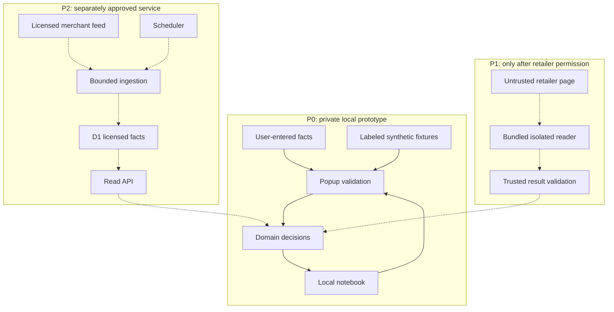

# Architecture — the smallest permitted extension slice

**Research date:** 8 October 2026. **Original status:** specification only. **Subsequent implementation update:** stages 01–02 established the native popup foundation and pure domain rules; build/tests ran, while extension installation, deployment and browser testing remain unperformed. See the [foundation](research/test-results/2026-10-08-foundation.md) and [domain](research/test-results/2026-10-08-domain-and-fixtures.md) reports. Source IDs resolve in [sources](research/sources.md). Decisions below are design choices unless marked VERIFIED FACT.

## 1. Selected architecture and release boundary

**DECISION:** start with native Chrome Manifest V3, TypeScript, semantic HTML/CSS and one toolbar popup. The first private prototype, P0, is a local offer notebook for exact branded wireless-mouse SKUs. The founder enters non-sensitive offer facts or uses clearly labeled synthetic fixtures. A URL is a reference the user supplies; saving it neither fetches the page nor proves retailer permission.

P0 needs only `storage`. It has no page reader, retailer host access, account system, server, analytics SDK, affiliate links or automatic monitoring. Store drafts and saved records locally. Compare only the facts actually supplied, preserving unknown delivery, warranty and condition fields. This architecture tests whether the comparison helps a shopper decide; it does not validate automated coverage or willingness to install.

P1 means a private permission-backed merchant pilot after the access gate in [data access](02-data-access.md): an eligible local reader, or a human-reviewed merchant file used for research and manual entry. It adds no customer import UI or hosted API. P2 means a public MVP only after user-value, access, privacy, security, release and cost gates. A one-merchant offer explainer may qualify; a cross-store feature additionally requires two independent eligible merchant/source integrations, not merely two marketplace sellers. A hosted backend is optional P2; server-delivered alerts remain deferred.

## 2. Why this stack

| Choice | Benefit for this scope | Cost or limitation | Decision |
|---|---|---|---|
| Native MV3 + TypeScript | Direct API use; a small auditable manifest; domain code independent of UI | Founder owns packaging and browser-version checks | Select |
| WXT + TypeScript | Framework provides extension build conventions and development conveniences | Additional tooling and upgrade surface; unnecessary for one popup | Reconsider when multiple browsers or entrypoints create measured maintenance pain |
| React within either option | Useful for a substantially larger interactive application | Adds a UI runtime and conventions without a demonstrated P0 need | Omit |
| Local storage | No production service bill or remote identity model | Local loss/reinstall risks; bounded history; no cross-device synchronization | Select |
| Workers + D1 | One possible later API and relational licensed-offer store | Rights, quotas, operational ownership and deployment checks remain gates | Conditional P2 |
| Supabase | Managed Postgres/auth capabilities if private accounts become necessary | Accounts are outside P0; Free has inactivity and resource limits | Alternative, not a second backend |

WXT's repository declares an MIT license and framework-agnostic extension support; that is evidence about the tool, not proof our extension works across browsers [T23]. Supabase currently lists a 500 MB Free database, 5 GB egress and two active projects, with pausing after one inactive week. Its Free comparison excludes automatic backups [T34]. This is sufficient reason not to add account infrastructure before the job requires it.

## 3. Version and tooling checks

**VERIFIED FACT:** Node's official release table lists 24 and 22 as LTS; choose a patched Node 24 release for the future build environment [T26]. Package versions are not frozen by this research.

| Component | Observed on research date | Required implementation action |
|---|---|---|
| esbuild | Release list labels 0.28.2 Latest; repository declares MIT [T27–T28] | Resolve exact official package, integrity and Node engine metadata; pin it; produce a successful bundle |
| TypeScript | Release list labels v7.0.2 Latest; repository declares Apache-2.0 [T30–T31] | Check current supported compiler/package and browser declarations; choose an exact compatible release |
| WXT, evaluated only | Retrieved list labels 0.21.2 Latest [T24] | Do not add to selected stack |
| WXT 0.21 requirements | Node >=22, TypeScript >=5.4; specified Vite peer ranges [T25] | These are documented floors, not proof any arbitrary pairing works |
| Chrome | API documentation reviewed; no installed browser benchmark | Record exact test versions and only claim those versions/platforms |
| Test runner | `node:test` is stable in the Node 24 documentation [T33] | Run tests against emitted JavaScript; browser behavior needs separate tests |

Some immutable package-file fetches failed, so esbuild's precise engine requirement remains UNKNOWN. Release pages showed day/month dates without reliably resolving a year for every tag. Do not turn a “Latest” label into a reproducible lockfile.

Use esbuild only as a development bundler. It does not check TypeScript types [T29]. The foundation prompt must establish `npm run typecheck`, `npm test` and `npm run build` as real scripts, with the compiler check separate from bundling. Tests should execute the same domain rules shipped in the extension. These are proposed commands, not recorded successful runs.

Set an explicit JavaScript/browser build target after selecting the first tested Chrome version. API availability, TypeScript compilation and a successful bundle establish different things; none alone establishes installed-extension compatibility.

## 4. Modules and ownership

Future source boundaries:

- `src/domain/`: money, offer identity, completeness, comparison eligibility and provenance validation. Pure functions; no browser APIs or HTTP.
- `src/storage/`: versioned local records, draft recovery, export, deletion and quota handling.
- `src/ui/popup/`: forms, summaries, saved-offer shortlist and accessible status/error presentation.
- `fixtures/synthetic/`: labeled fictional examples, deliberately including mismatches and missing costs.
- `src/adapters/` and `src/background/`: absent until P1 is authorized and a source is eligible.
- An optional backend folder is created only by the gated backend prompt.

Shared domain types are specified in [contracts](06-data-and-api-contracts.md). UI code never invents provenance or converts a missing field into zero. Avoid a router, state-management framework or microservice boundary for this screen.

The popup can invoke domain and storage modules directly. A background service worker is unnecessary for P0. When a later adapter requires coordination, add a small worker with explicit message types. Never move pure domain decisions into renderer-specific code merely to share them.

## 5. Trust boundaries and conditional flows

The following is a **target dependency map**, not implemented infrastructure. Solid arrows describe P0. Dashed arrows describe gated additions.

A retailer page is untrusted even when the merchant approved integration. The bundled reader checks its actual origin/path before reading DOM. It returns allowlisted facts; the popup or conditional worker validates document/frame/operation binding, size and schema before saving. Abort on navigation or excluded contexts. Chrome treats content scripts as less trustworthy than a privileged worker [T38]. A feed requires both a valid contract and structural validation; HTTPS alone does not establish correctness.

The future read API returns licensed offer facts. It does not receive the user's notebook or browsing trail. Comparing a feed subset locally keeps private choices on the device. A server can still observe request metadata; privacy disclosure must describe actual logs and transport behavior before enabling it. Private-watch and account APIs are outside the current specification.

## 6. Persistence and popup lifetime

**VERIFIED FACT:** `storage.local` currently has a 10 MB limit and is removed with the extension. Access can be restricted to trusted extension contexts. `storage.sync` has different transmission semantics and a much smaller quota [T02]. Select local storage and apply the trusted-context restriction; do not use sync or request `unlimitedStorage`.

P0 caps are 25 saved offers, 500 observations, comparison of at most 3 offers, a 4 MiB soft warning and 5 MiB hard application limit. Use the contracts as the canonical limits. The active history window is 90 days; older observations leave current summaries but remain stored until explicit deletion and still count toward capacity. Reject a 26th offer or 501st observation. At 25 offers, an existing offer can still receive an observation if other caps permit it. Metadata fixes remain possible within the byte limit; export and data-reducing deletion remain available. Reject growth beyond 5 MiB; never silently evict records.

A popup closes when focus moves away [T40]. Persist valid drafts during editing; show “Saved” only after the corresponding write succeeds. Do not rely on unload to save work. A recovered draft remains a draft until confirmed. A change whose write was not acknowledged can be lost on close; no last-keystroke guarantee is made.

P0 assumes one editing window. `storage.local` is not a transactional database; serializing operations inside one popup does not establish cross-window atomicity. Do not promise compare-and-swap, atomic multi-record migrations or simultaneous-edit safety. Before a broader pilot, test this limitation and choose a single-writer coordinator or IndexedDB transactions if concurrent editing becomes a requirement.

Migrations must be versioned, deterministic and recoverable. Validate a migrated candidate before replacing active data. An interrupted migration must leave the prior version readable or expose a recovery/export path, rather than clearing it. Client input, corrupted stored records and fixture objects all enter through the same domain validators. User-facing import remains deferred.

## 7. Eligible page access later

P0's exact retailer host set is **empty**. Do not ship a manifest containing illustrative merchant domains.

For a P1 reader, request only the justified user-triggered capabilities: `activeTab` and `scripting`. A user gesture activates temporary access; an origin change ends that grant [T03–T04]. The bundled adapter registry separately restricts supported merchant origins and approved product paths. A browser grant is a technical capability, not a retailer license.

Compare two future modes:

| Mode | Scope | Feature tradeoff |
|---|---|---|
| Explicit “Read this offer” | Temporary active-tab access plus internal merchant allowlist | User repeats action on a new origin; select initially |
| Optional approved retailer host | Exact HTTPS origin requested for an implemented feature | More persistent access; consider only after showing the benefit and documenting permission revocation |

The placeholder `https://<approved-retailer-host>/*` explains a future pattern and is **not valid copy-ready manifest data**. Replace it only with an origin established by the signed access record. Host-permission paths are ignored by Chrome; product-only/checkout exclusions must also be enforced by code [T39]. Denial leaves the manual notebook usable. No all-sites permission, cookies, history or checkout reading is planned.

## 8. Worker lifecycle and achievable checking

A later MV3 worker can terminate after idle time and lose global variables [T01]. Persist committed observations and work status; register listeners at startup; keep each action short. Idempotent operation IDs prevent a retried save from creating duplicate observations. Recompute display state from durable facts rather than relying on a live process.

P0 has no alarms, notifications or Watch entity. Its saved-offer shortlist does not fetch prices. Opening it does not refresh observation timestamps. Watch and Notification contracts are deferred design entities, not implemented features.

A future local reminder may run only when Chrome and the device permit it. Alarms can be delayed; missed repeating alarms after sleep are coalesced. Current documentation adds `persistAcrossSessions` in Chrome 150, so earlier-version behavior cannot be assumed [T06]. Check required alarms at startup and distinguish “time to recheck” from “price changed.”

Browser notifications require a separate permission and an enablement check [T07]. They do not provide server-backed delivery to a closed browser. Any always-on alert promise needs an eligible remote source, durable scheduler, deduplication/outbox, a verified delivery provider, consent and an affordable operating budget. No provider is selected here.

## 9. Optional backend gate and degradation

If a small licensed merchant feed qualifies, evaluate one Worker and one D1 database; serve a bounded, cacheable catalog subset, with private choices staying local. Use canonical merchant IDs; no pasted-URL fetch, account, observation-upload or private-watch endpoint is specified. No LLM is required in any customer request path.

Cloudflare's Free CPU allowance applies to scheduled invocations as well as HTTP work [T16]. Therefore a free scheduler is not permission or capacity for expensive browser collection. D1's per-database Free cap is 500 MB, distinct from its account-wide allowance [T18]. The detailed workload model belongs in [costs](10-business-and-costs.md).

**INFERENCE:** reviewed Cloudflare agreements permit entity customers and did not reveal a hobby-only condition for this proposed service; acceptable use, licensing and plan restrictions still apply [T21–T22]. Its product page advertises starting without a card; no signup was attempted [T20]. Supabase remains an unqualified alternative for a future account requirement, not a deployable failover plan.

On quota pressure, stop ingestion before exhausting capacity, preserve existing local records and display a dated stale/service-unavailable state. Do not silently pay for upgrades, hide missing observations or spread accounts to evade limits. Choosing dependencies, testing the actual free-tier path and approving any external deployment remain implementation gates.

## 10. Unresolved decisions

The first implementation must resolve exact dependency pins, tested browser/OS versions, local storage recovery behavior and the at-rest privacy question in [security](08-security-privacy-policy.md). P1 additionally requires a merchant access record and actual adapter fixtures; P2 requires cost measurements, operational ownership and a tested restoration path. No deployment compatibility or store approval is claimed.

